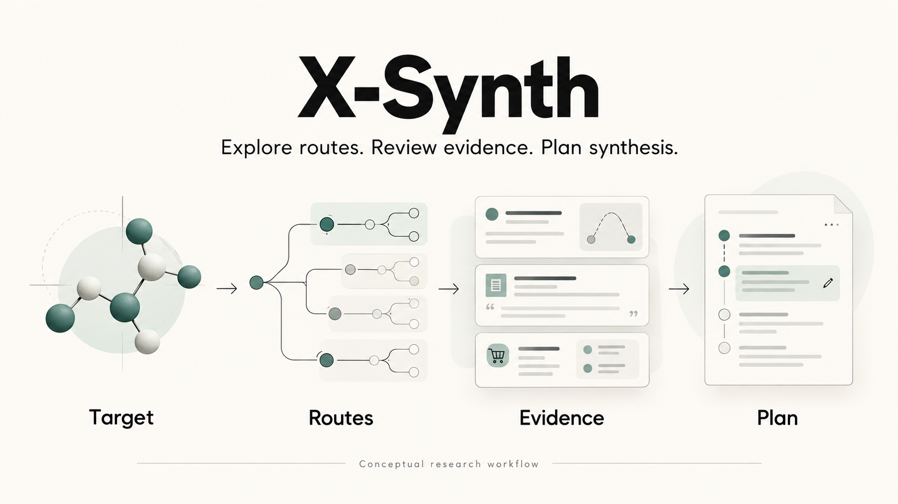

# X-Synth

面向药物化学、合成化学与工艺研究的合成研究工作台。从目标分子出发，探索逆合成路线，将反应步骤、原料证据和研究记录放在一起比较与复核。

X-Synth 基于 ASKCOS V2，界面默认使用英语，支持简体中文。

*概念工作流示意，展示从目标结构到路线研究方案的过程。*

## 从目标结构到路线研究

1. **确认结构**：绘制分子、输入 SMILES，或从 MOL/SDF/SMILES 文件中选择化合物
2. **探索路线**：使用 MCTS 与 RetroStar 搜索策略，比较候选路线及其起始原料
3. **审查依据**：查看反应步骤、正向预测、可行性评分、参考记录与结构级采购证据
4. **整理方案**：创建独立路线副本，补充反应与备注，导出图示、原料清单和可继续编辑的路线文档

任务历史保存搜索输入、状态与候选结果，便于回看、分组和再次研究。重新搜索可以沿用已有输入，不会自动提交任务。

## 帮助解决哪些问题

### 比较路线，而不只看一张结果图

在完整分支中查看中间体、反应步骤和外部起始原料，结合不同路线的依据进行化学评估。采购检查保留具体结构与目录来源，帮助识别需要进一步确认的盐型、立体化学、电荷或同位素身份。

### 将模型建议与参考证据放在一起

在已配置的模型和数据支持下，开展一步逆合成、条件推荐、产物与杂质候选分析，并检索参考反应。模型预测、原始文献条件与采购目录证据分别保留，避免把不同来源的信息混为同一种结论。

### 把备选方案整理成可复核的研究材料

编辑路线副本，拖动和连接节点，补充完整反应，撤销或重做修改。导出完整路线 PNG、原料 CSV 和可重新导入的 X-Synth JSON；分子还可导出为 MOL/SDF/SMILES。

修改化学结构或连接后，原核验等级失效，文档作为草稿继续研究；布局与备注修改保留原计算来源。

### 为后续实验准备计算依据

使用结构描述符与复杂度评估、实际批次的物料核算，以及基于明确选择的实测 CSV 记录的实验优化。模型与环境就绪后，实验优化可推荐下一批离散条件，并区分预测响应与实测结果。

## 开始使用

支持 **Linux / WSL、Python 3.12、Node.js 24**。按[安装与运行指南](docs/operations.md#目录与安装)准备产品环境、独立的 ASKCOS 环境和合法取得的模型、数据库与采购目录，再按[启动说明](docs/operations.md#配置与启动)打开工作台。

源码不包含模型权重、商业数据或私人历史。各项能力取决于实际安装的模型与环境；缺少必要依赖时不会以模拟结果替代。具体输入与操作见[工作区使用说明](docs/workspace-workflows.md)。

## 如何理解结果

- **模型核验不等于实验验证**：评分与模板重构不能证明实验成功；杂质候选不代表实测杂质或含量
- **目录证据不等于供货承诺**：库存来自固定快照，采购前仍需确认结构、现货、价格与授权
- **路线数量不作保证**：当前仅在获得 3–10 条合格路线家族时标为完成；任意目标都可能出现路线不足或未闭合
- **计算辅助研究判断**：物料核算不预测工业放大，实验优化与路线建议均需专业人员复核

当前已集成的路线生成引擎为 ASKCOS V2。完整路线文档导入仅支持 X-Synth JSON。

默认使用本机单用户访问。共享部署必须启用经过服务端验证的身份，不能直接公开本地模式；模型来源和依赖须遵守[安全使用要求](docs/operations.md#原子映射安全边界)。

## 许可与致谢

自研代码使用 [Apache-2.0](LICENSE)。ASKCOS V2、其延续的 Vue 工作台与其他第三方组件保留原许可和版权，见 [NOTICE](NOTICE)。

模型、训练数据、反应资料与供应商数据的授权独立于源码许可；部分 ASKCOS / Reaxys 模型采用非商业许可。使用或分发前须分别确认。

